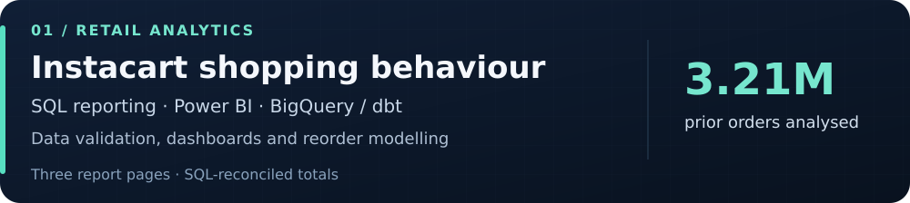
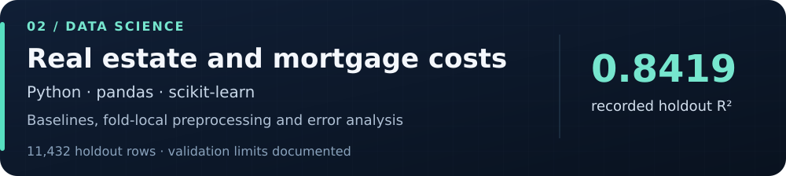
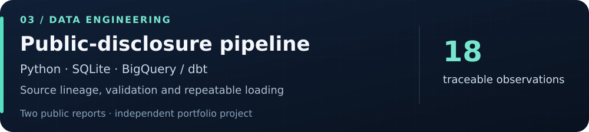

<a href="#selected-projects">Selected projects</a> · <a href="#recent-project-updates">Recent work</a> · <a href="#tools-and-methods">Tools and methods</a> · <a href="https://www.linkedin.com/in/saurabh-zambare-b29b851b4/">LinkedIn</a>

## Hi, I'm Saurabh

I build **SQL reporting workflows, Power BI reports, Python models and data pipelines**. I start with the question, check the data and explain what the results support.

Before building these projects, I spent nearly five years at **McDonald’s Canada**, progressing into department management. Inventory, waste and variance reporting taught me to investigate discrepancies and connect the numbers to what was happening in the operation. I bring that same approach to my technical work.

**Based in Vadodara, India · Open to data analytics, data science and junior data engineering opportunities.**

## Selected projects

Independent portfolio projects and coursework, with implementation, checks and results linked below.

**What to inspect:** [Three dashboard previews](https://github.com/Saurabhzambare/instacart-sql-powerbi-analysis#report-preview) · [SQL validation](https://github.com/Saurabhzambare/instacart-sql-powerbi-analysis#workflow-and-validation) · [Reorder model evaluation](https://github.com/Saurabhzambare/instacart-sql-powerbi-analysis/blob/main/docs/ML_REORDER_RESULTS.md)

SQL-reconciled reporting and customer-disjoint model evaluation. Recorded test mean per-order F1: **0.3424**, versus **0.3336** for the purchase-frequency baseline.

**What to inspect:** [Model comparison chart](https://github.com/Saurabhzambare/Real_Estate_Capstone#results-at-a-glance) · [Evaluation and limitations](https://github.com/Saurabhzambare/Real_Estate_Capstone/blob/main/docs/EVALUATION_SUMMARY.md)

Fold-local preprocessing, baseline comparisons and holdout diagnostics. Full-holdout **RMSE 252.27**; overlap sensitivity and limits on geographic generalization are documented.

**What to inspect:** [Architecture and output preview](https://github.com/Saurabhzambare/gacl-public-disclosure-pipeline#pipeline-preview) · [Source register](https://github.com/Saurabhzambare/gacl-public-disclosure-pipeline/blob/main/docs/SOURCES.md) · [Current status](https://github.com/Saurabhzambare/gacl-public-disclosure-pipeline/blob/main/docs/STATUS.md)

Validation, duplicate-safe SQLite loads and BigQuery reconciliation; **3 dbt views / 7 SQL tests** documented. Power BI is in progress. This independent project is not affiliated with or commissioned by GACL.

### More engineering and modelling

| Project | Evidence to explore |
|---|---|
| **[Discipline System](https://github.com/Saurabhzambare/discipline-system)** | Django REST Framework, React, PostgreSQL and JWT. Duplicate-completion handling and local-date quest logic; **322 backend tests passed** at the 23 November 2026 checkpoint. [Workflow and setup](https://github.com/Saurabhzambare/discipline-system#application-workflow-preview). |
| **[Mercedes-Benz manufacturing analysis](https://github.com/Saurabhzambare/Mercedes-Benz-Greener-Manufacturing)** | Exploratory analysis plus a separate five-fold categorical Ridge experiment: mean CV **RMSE 8.3867**, versus **12.6727** for the mean baseline. [Comparison and scope](https://github.com/Saurabhzambare/Mercedes-Benz-Greener-Manufacturing/blob/main/docs/BASELINE_EVALUATION.md). |

*Model metrics are recorded offline project results. Scope, evaluation methods and limitations are documented in the linked repositories.*

## Recent project updates

Latest commits from the five featured repositories. Updated automatically each day; dates describe repository activity.

<!-- RECENT-WORK:START -->
| Date (UTC) | Project | Latest update |
|---|---|---|
| 25 Nov 2026 | [Public-disclosure pipeline](https://github.com/Saurabhzambare/gacl-public-disclosure-pipeline) | [docs: close Step 3 local commit checkpoint](https://github.com/Saurabhzambare/gacl-public-disclosure-pipeline/commit/3df36db3adbbd08592b1df3ae9ebb4c693305fee) |
| 23 Nov 2026 | [Discipline System](https://github.com/Saurabhzambare/discipline-system) | [docs: improve portfolio previews and evidence navigation](https://github.com/Saurabhzambare/discipline-system/commit/574b75d35c82d0581335efe62785a0772fc8992e) |
| 23 Nov 2026 | [Mercedes-Benz analysis](https://github.com/Saurabhzambare/Mercedes-Benz-Greener-Manufacturing) | [docs: improve portfolio previews and evidence navigation](https://github.com/Saurabhzambare/Mercedes-Benz-Greener-Manufacturing/commit/a408e68acadfe72511493e37ed7948e0bbf1c1ab) |
| 23 Nov 2026 | [Real estate modelling](https://github.com/Saurabhzambare/Real_Estate_Capstone) | [docs: improve portfolio previews and evidence navigation](https://github.com/Saurabhzambare/Real_Estate_Capstone/commit/b87ceabc4908e241b1472176abfebb99ac231b5f) |
| 23 Nov 2026 | [Instacart retail analytics](https://github.com/Saurabhzambare/instacart-sql-powerbi-analysis) | [docs: improve portfolio previews and evidence navigation](https://github.com/Saurabhzambare/instacart-sql-powerbi-analysis/commit/a55a9844bbdeb4df0136dbdae5a3d4c4d168f24b) |
<!-- RECENT-WORK:END -->

## Tools and methods

| Area | Applied in my projects |
|---|---|
| **Analysis and reporting** | SQL Server, SQL, Power Query, Power BI, DAX and Tableau |
| **Python and modelling** | pandas, NumPy, scikit-learn, baseline comparisons, cross-validation and error analysis |
| **Data workflows** | Data-quality checks, source lineage, SQLite, BigQuery, dbt and repeatable loads |
| **Software development** | Django, Django REST Framework, React, PostgreSQL, JWT, Docker and GitHub Actions |

<strong>Education and professional background</strong>

Computer Programming studies at **Sault College, Canada**, and an **Integrated B.Tech in Computer Science from ITM Vocational University, India**.

My operations experience includes team coordination, coaching and decisions under pressure. The repositories above show my independent technical work and coursework.

[Additional Python data coursework](https://github.com/Saurabhzambare/Movielens-Case-Study-Python) · [Scala/Spark banking analysis](https://github.com/Saurabhzambare/Market-Analysis-in-Banking-Domain)

---

**Hiring for a junior data or Python role?** [Connect with me on LinkedIn](https://www.linkedin.com/in/saurabh-zambare-b29b851b4/) — I'm happy to walk through the code, checks and decisions behind these projects.
